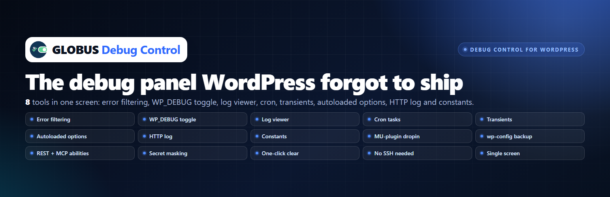
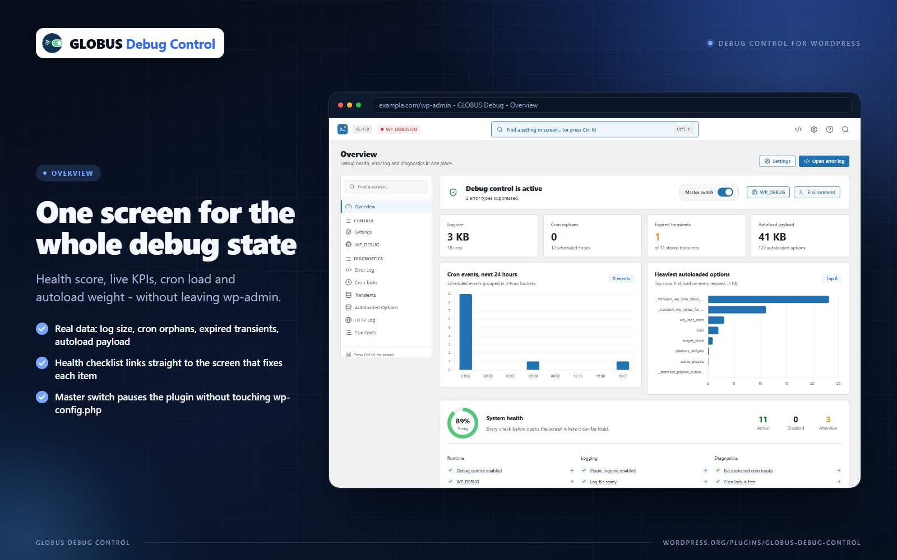
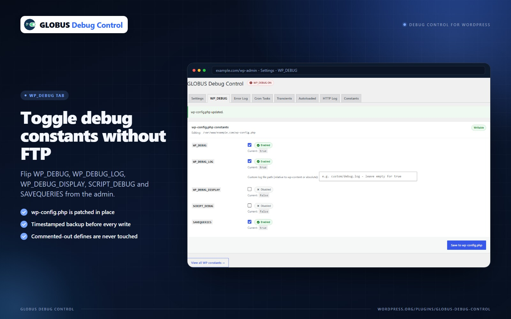
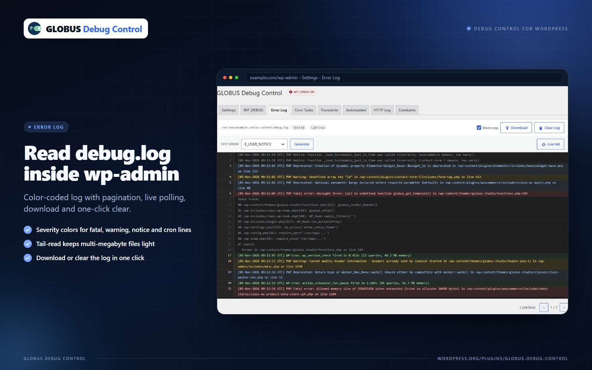
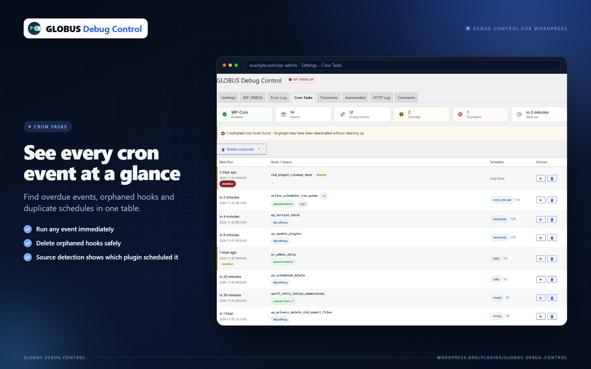
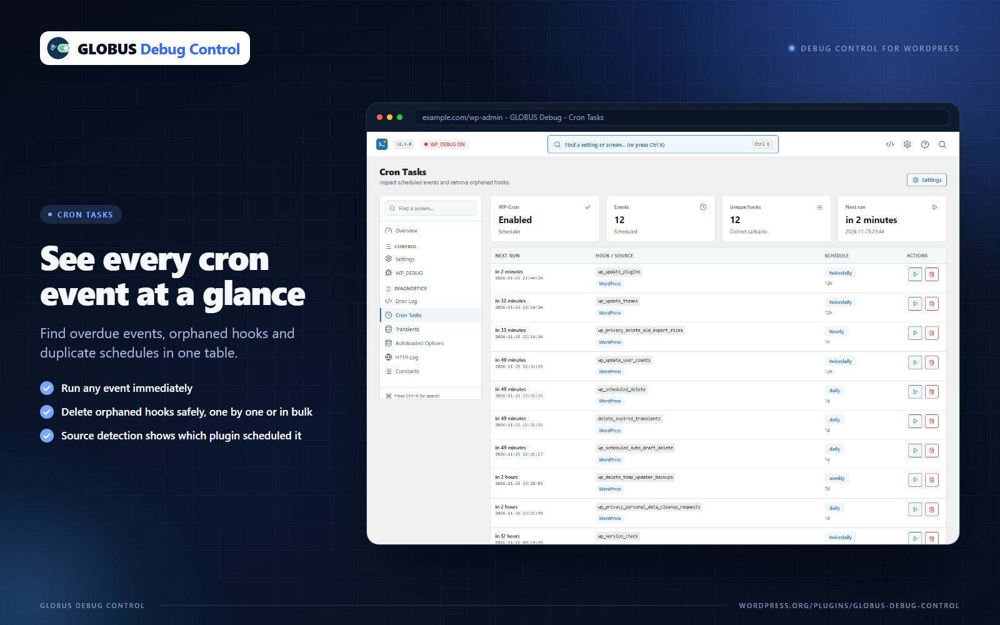
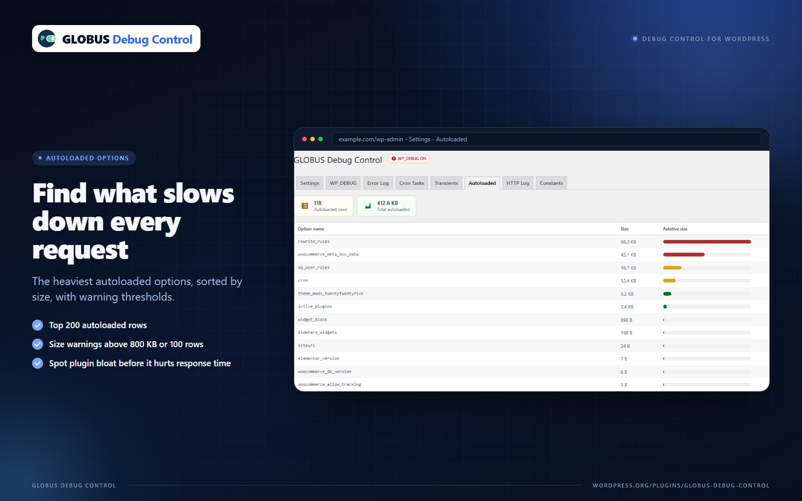
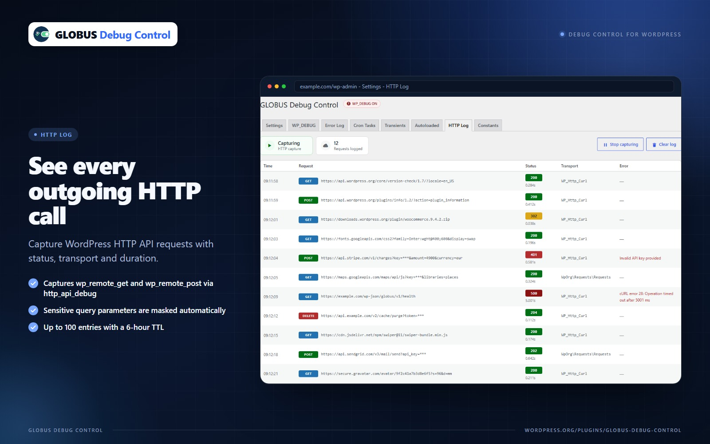
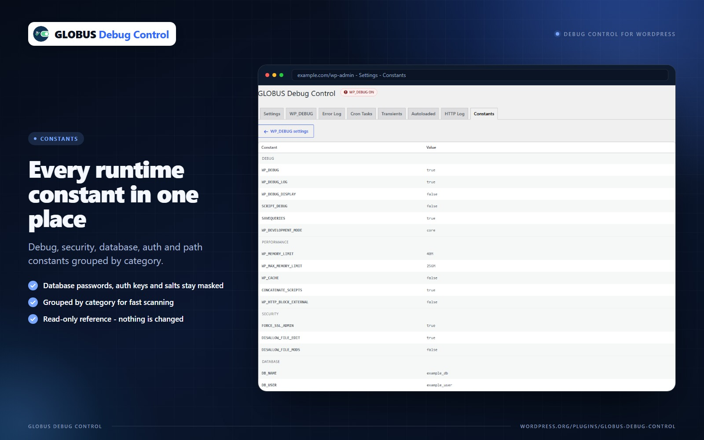

<p align="center">
  
</p>

# GLOBUS Debug Control

[](https://wordpress.org/plugins/globus-debug-control/)
[](https://wordpress.org/plugins/globus-debug-control/)
[](https://wordpress.org/plugins/globus-debug-control/)
[](LICENSE)

**The debug panel WordPress forgot to ship.** Eight tools in one admin screen: error
filtering, a `WP_DEBUG` switch, a log reader, cron, transients, autoloaded options,
the HTTP API log and runtime constants - no SSH, no FTP, no `wp-config.php` editing.

Stop wading through hundreds of irrelevant notices. Turn `WP_DEBUG` on, silence the
noise you did not write, read the log, find the slow query and the broken cron hook,
then switch debug off again. All from **Settings - GLOBUS Debug Control**.

[**Install from WordPress.org**](https://wordpress.org/plugins/globus-debug-control/) ·
[Support forum](https://wordpress.org/support/plugin/globus-debug-control/) ·
[Report a security issue](SECURITY.md)

## Screenshots

| Debug control | WP_DEBUG without editing files |
| --- | --- |
|  |  |

| Read the error log | Cron events and orphaned hooks |
| --- | --- |
|  |  |

| Transients and expired rows | Autoloaded option bloat |
| --- | --- |
|  |  |

| Outgoing HTTP calls | Runtime constants, secrets masked |
| --- | --- |
|  |  |

## Why this plugin exists

A broken WordPress site usually fails in one of five places, and core gives you a
text file and a constant for all of them:

- A wall of notices and deprecations hides the one fatal error that matters.
- Turning `WP_DEBUG` on means editing `wp-config.php` - and remembering to undo it.
- `debug.log` is a 200 MB file you have to download and grep.
- A cron event that never fires stays invisible until someone notices stale data.
- Autoloaded options and stuck transients quietly slow every single request.

GLOBUS Debug Control puts each of those on one screen, with the guard rails that
production sites need.

## Everything in one screen

| Tab | What you get |
| --- | --- |
| **Settings** | Suppress notices, deprecations, warnings and strict errors independently. Display mode: inherit, always on, always off. Custom log path and rotation limit. Optional MU-plugin dropin. |
| **WP_DEBUG** | Toggle `WP_DEBUG`, `WP_DEBUG_LOG`, `WP_DEBUG_DISPLAY`, `SCRIPT_DEBUG` and `SAVEQUERIES`. `wp-config.php` is patched in place with a timestamped backup; commented-out defines are never touched. |
| **Error Log** | Color-coded `debug.log` with line numbers, pagination, live polling, download and one-click clear. Files over 2 MB are read from the tail. |
| **Cron Tasks** | All scheduled events with next run, recurrence and arguments. Overdue and orphaned hooks are highlighted; run an event now or delete an orphan. |
| **Transients** | Every database transient with size and expiry. Delete single rows or purge all expired entries at once. Object-cache-only transients are labelled as such. |
| **Autoloaded** | The 200 heaviest autoloaded options, sorted by size, with warnings above 800 KB or 100 rows. |
| **HTTP Log** | Outgoing `wp_remote_*` requests via `http_api_debug`: method, status, transport class and duration. Sensitive query parameters are masked before an entry is stored. |
| **Constants** | All WordPress-related runtime constants grouped by category. Database passwords, auth keys and salts are masked automatically. |

## Production-safe by default

- **Errors never leak into JSON.** Display is forced off in AJAX, REST API, WP-Cron,
  WP-CLI and XML-RPC contexts, whatever the screen setting says.
- **Secrets stay secret.** HTTP query parameters and constant values are masked
  before they reach the admin table.
- **Your config is backed up.** Every `wp-config.php` write creates a timestamped
  copy first and leaves commented-out defines alone.
- **No autoload bloat.** Plugin options are stored with autoload disabled.
- **Optional early interception.** The MU-plugin dropin applies your filter before
  any regular plugin loads, and updates itself after a plugin update.
- **No telemetry, no accounts, no external calls.** MIT licensed, GPL-compatible.

## MCP and REST abilities

On WordPress 6.9+ the plugin exposes its controls as Abilities API tools for MCP and
REST clients (all require `manage_options`):

| Ability | Purpose |
| --- | --- |
| `gdc/get-schema` | Option schema with types, defaults and allowed values; wp-config constants |
| `gdc/get-options` | All plugin options plus effective runtime state |
| `gdc/update-options` | Patch any option by key; sanitised and applied immediately |
| `gdc/reset-options` | Restore defaults (`confirm=true`) |
| `gdc/get-log` | Tail of the error log with severity levels and an optional filter |
| `gdc/clear-log` | Truncate the log file (`confirm=true`) |
| `gdc/get-wp-config` | Current debug constants from `wp-config.php` |
| `gdc/update-wp-config` | Write debug constants into `wp-config.php` (`confirm=true`) |

## Requirements

- WordPress 5.2 or higher
- PHP 7.4 or higher

## Installation

1. In the WordPress admin open **Plugins - Add New**, search for
   "GLOBUS Debug Control", then click **Install** and **Activate**.
2. Or install from the [WordPress.org plugin page](https://wordpress.org/plugins/globus-debug-control/).
3. Open **Settings - GLOBUS Debug Control** and pick your error types.

With WP-CLI:

```sh
wp plugin install globus-debug-control --activate
```

A sensible production setup: suppress all error types, disable error display, enable
logging to a file, and keep the `php-error` body class removal active.

## FAQ

**Does it require `WP_DEBUG`?** No. Display and logging settings work independently,
and the WP_DEBUG tab lets you toggle the constants from the admin.

**Will it hide errors in REST or AJAX responses?** Yes - errors are always suppressed
in non-HTML contexts so JSON stays valid.

**Is it safe to leave installed on a live site?** Yes. The diagnostic tabs are
read-only, and the production setup above is the recommended one.

**Does it write to my files?** Only when you ask: saving the WP_DEBUG tab patches
`wp-config.php` after making a backup, and the optional dropin writes one file to
`wp-content/mu-plugins/`. Nothing else touches the filesystem.

**Do translations ship in the ZIP?** No. The plugin uses WordPress language packs;
translation drafts for Russian, Ukrainian, German, French and Spanish live in
[`docs/translations`](docs/translations/) and are submitted through
[translate.wordpress.org](https://translate.wordpress.org/projects/wp-plugins/globus-debug-control/).

## Development

This repository contains both the deployable plugin and its development tooling.

```
globus-debug-control/     deployable plugin (this is what ships)
  globus-debug-control.php  main entry, singleton Globus_Debug_Control
  include/                  one file per feature (traits and standalone classes)
  assets/                   admin CSS and JS
  languages/                translation template
tests/                    PHPUnit tests
tools/mcp-smoke-test.mjs  read-only MCP smoke test
tools/screenshots/        Playwright renderer for screenshots, banners and the OG card
docs/screenshots/         generated WordPress.org screenshots
docs/wordpress-org/       icons and banners for the WordPress.org listing
```

```sh
composer install          # install dev dependencies
composer test             # run PHPUnit
composer cs               # lint with PHPCS (WordPress standard)
composer cs-fix           # auto-fix with PHPCBF
composer pot              # regenerate languages/globus-debug-control.pot (WP-CLI)
```

Run `composer cs` and `composer test` before committing. For the live WordPress,
MCP, Redis/Memcached, multisite and release procedures, see
[`docs/TESTING.md`](docs/TESTING.md).

### Media

The listing images are generated from the real admin markup, not drawn by hand:

```sh
cd tools/screenshots
npm install
npm run marketing         # capture the tabs, compose docs/screenshots/screenshot-N.jpg
npm run brand             # banners and the Open Graph card
```

Slide copy lives in [`tools/screenshots/marketing/slides.json`](tools/screenshots/marketing/slides.json);
banner copy lives in `tools/screenshots/marketing/render-brand.mjs`. See
[`tools/screenshots/README.md`](tools/screenshots/README.md) for details.

## Deployment

Pushing to `main` triggers `.github/workflows/DEPLOY.yml`:

1. `globus-debug-control/` is rsynced to production. Root-level development files
   (`composer.json`, `tests/`, `tools/`) are not shipped.
2. When `RELEASE_MODE` and `PUBLISH_WPORG` are set to `"true"` in the workflow
   `env`, the same run publishes to WordPress.org. It checks that `Version:` in the
   plugin header matches `Stable tag:` in `readme.txt`, stages a clean copy of
   `globus-debug-control/`, commits it to SVN `trunk`, copies `trunk` to
   `tags/<version>`, and syncs `docs/screenshots/screenshot-*.jpg`, the banners and
   the icons to SVN `assets`.

Release checklist:

1. Bump `Version:` in `globus-debug-control/globus-debug-control.php`, `Stable tag:`
   in `globus-debug-control/readme.txt`, and add a changelog entry.
2. Set `RELEASE_MODE: "true"` and `PUBLISH_WPORG: "true"`.
3. Commit and push to `main`.
4. Set both flags back to `"false"` and push again.

Set `WPORG_DRY_RUN: "true"` to run the SVN steps without committing.

Required repository secrets:

| Secret | Purpose |
| --- | --- |
| `GSS` | SSH private key for the production server |
| `SSH_PASSWORD` | SSH password for the same server |
| `SSH_PORT`, `SSH_USER`, `SSH_HOST`, `SSH_PATH` | rsync target on the production server |
| `SVN_USERNAME`, `SVN_PASSWORD` | WordPress.org account used by the SVN deploy |

## License

MIT. See [LICENSE](LICENSE).

## Links

- [WordPress.org plugin page](https://wordpress.org/plugins/globus-debug-control/)
- [Support forum](https://wordpress.org/support/plugin/globus-debug-control/)
- [Translate the plugin](https://translate.wordpress.org/projects/wp-plugins/globus-debug-control)
- [SVN repository](https://plugins.svn.wordpress.org/globus-debug-control/)
- [Author](https://leonidov.dev)
