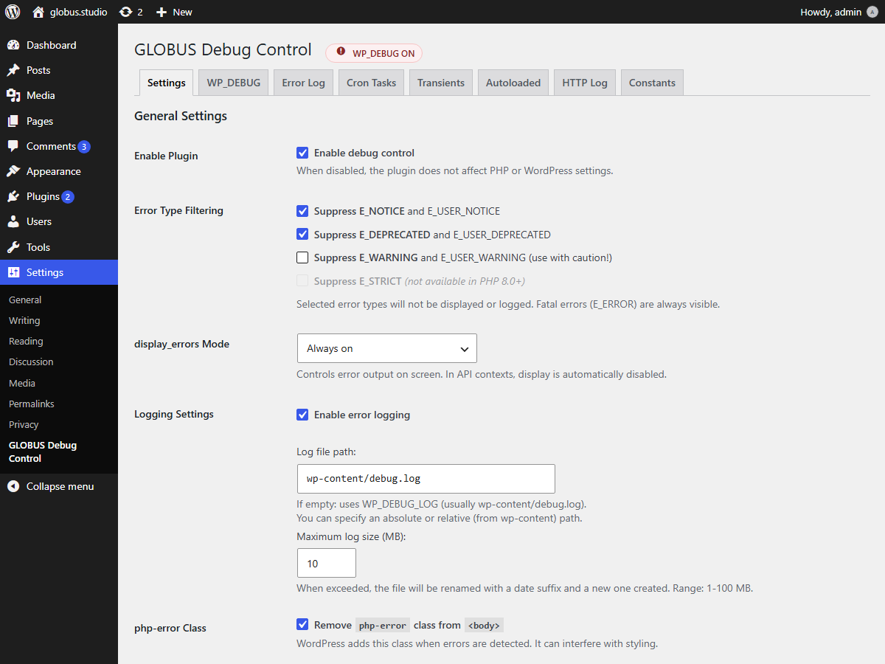
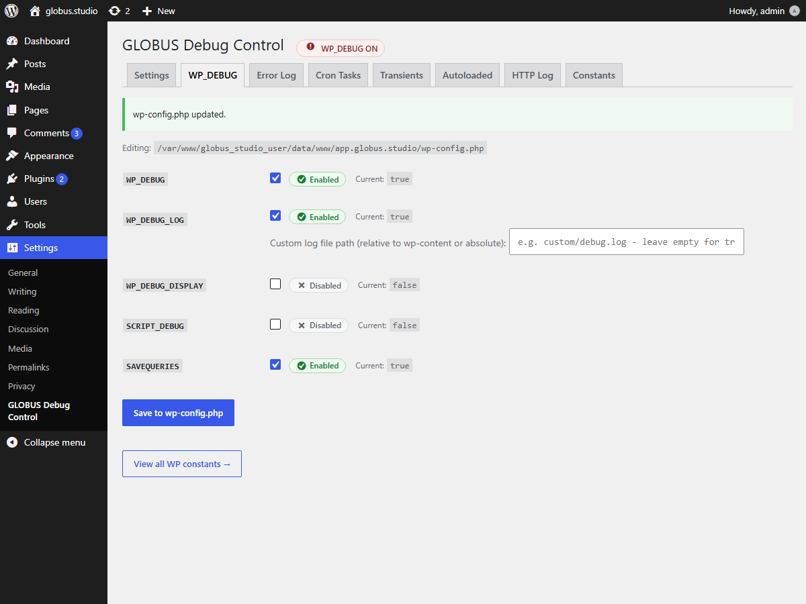
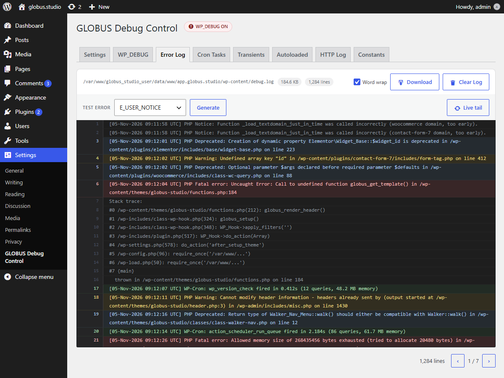
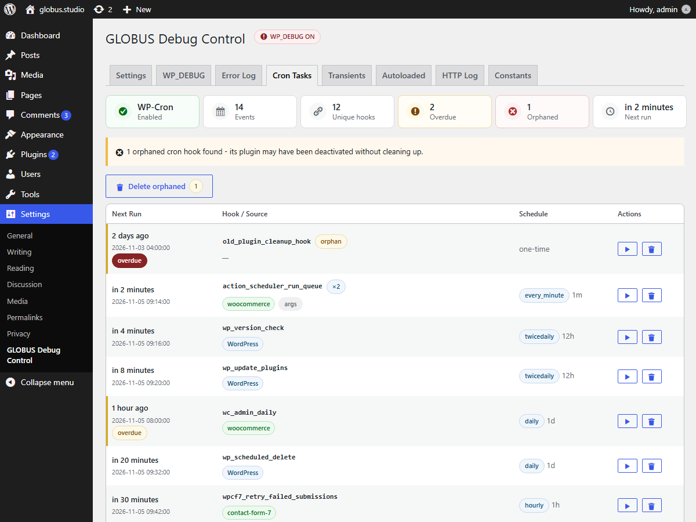
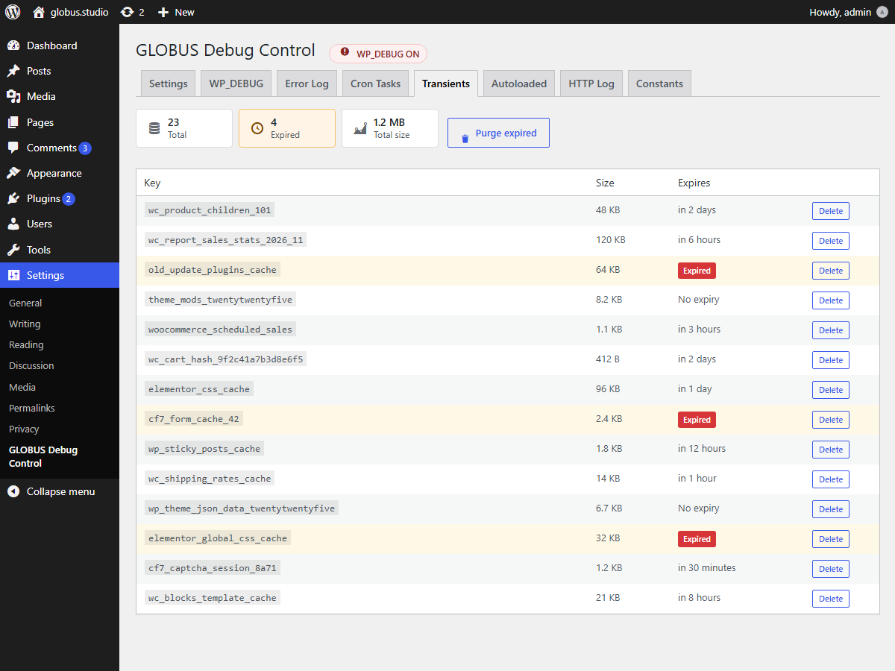
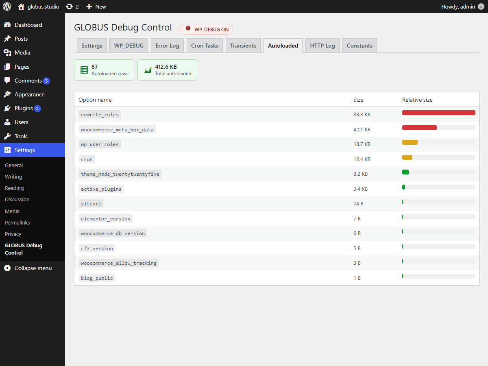
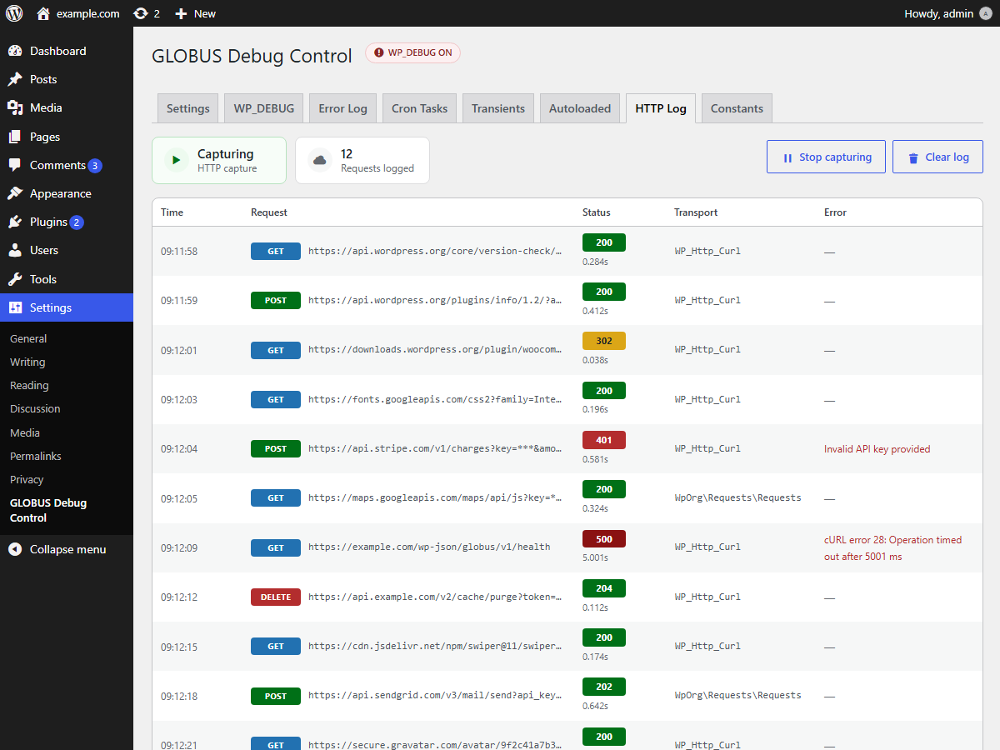
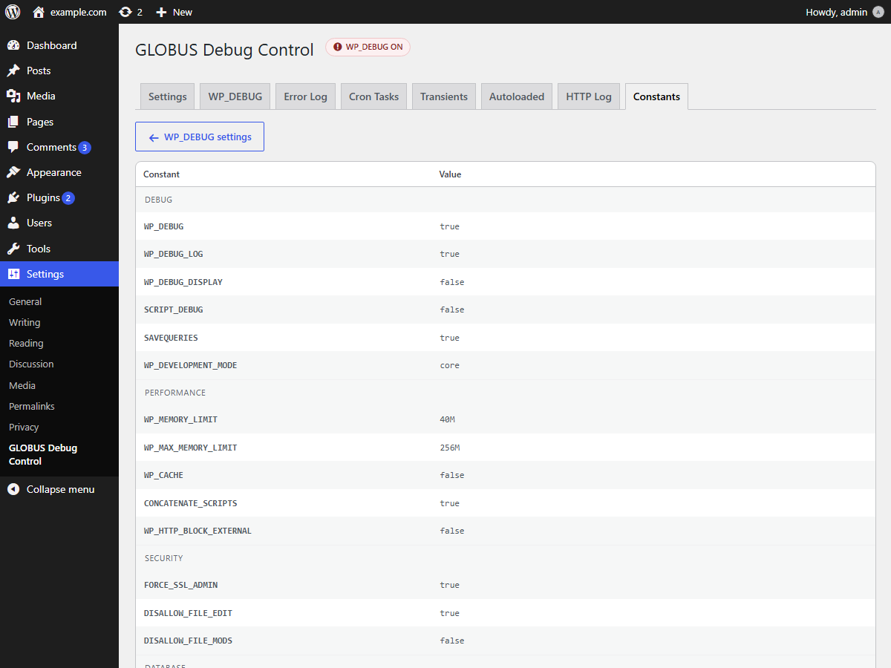

# GLOBUS Debug Control

[](https://wordpress.org/plugins/globus-debug-control/)
[](https://wordpress.org/plugins/globus-debug-control/)
[](https://wordpress.org/plugins/globus-debug-control/)
[](LICENSE)

WordPress debug dashboard in the admin panel. Filter PHP error types, toggle `WP_DEBUG`
constants, read `debug.log`, and inspect cron events, transients, autoloaded options,
outgoing HTTP calls, and runtime constants - without SSH or editing files by hand.

Stop wading through hundreds of irrelevant PHP notices. Debug WordPress on your terms -
filter errors, toggle `WP_DEBUG`, read logs, and diagnose performance issues without
leaving the admin panel or editing a single file.

## Screenshots

| Settings | WP_DEBUG |
| --- | --- |
|  |  |

| Error Log | Cron Tasks |
| --- | --- |
|  |  |

| Transients | Autoloaded |
| --- | --- |
|  |  |

| HTTP Log | Constants |
| --- | --- |
|  |  |

The images are rendered from HTML templates with Playwright, so they can be
regenerated after any UI change - see [`tools/screenshots`](tools/screenshots/README.md).

## Features

The plugin adds eight tabs under **Settings -> GLOBUS Debug Control**:

- **Settings** - suppress notices, deprecations, warnings, and strict errors independently;
  choose error display mode (inherit, on, off); configure log file path and rotation limit;
  remove the `php-error` body class; install an optional MU-plugin dropin for early
  error interception.
- **WP_DEBUG** - toggle `WP_DEBUG`, `WP_DEBUG_LOG`, `WP_DEBUG_DISPLAY`, `SCRIPT_DEBUG`,
  and `SAVEQUERIES` directly from the admin. `wp-config.php` is patched in place with a
  timestamped backup; commented-out defines are never touched.
- **Error Log** - read `debug.log` in a CodeMirror editor with line numbers, severity
  colors, pagination, live polling, download, and one-click clear. Large files are read
  from the tail to keep memory usage low.
- **Cron Tasks** - list all scheduled events, highlight overdue and orphaned hooks,
  detect duplicate schedules, run an event immediately, or delete orphaned hooks.
- **Transients** - show database-stored transients with size and expiry, delete single
  entries, or purge all expired ones in one click.
- **Autoloaded** - list the heaviest autoloaded options (top 200) with size warnings, so
  you can spot what inflates every request.
- **HTTP Log** - capture outgoing WordPress HTTP API requests via `http_api_debug`, with
  method, status code, response time, transport class, and masked sensitive query params.
- **Constants** - group all WordPress-related runtime constants by category, with database
  passwords, auth keys, and salts automatically masked.

PHP errors are always suppressed in AJAX, REST API, WP-Cron, WP-CLI, and XML-RPC contexts,
so JSON responses stay clean regardless of the display setting.

## Requirements

- WordPress 5.2 or higher
- PHP 7.4 or higher

## Installation

1. Install from the WordPress admin: **Plugins -> Add New**, search for
   "GLOBUS Debug Control", then click **Install** and **Activate**.
2. Or download the ZIP from [wordpress.org](https://wordpress.org/plugins/globus-debug-control/)
   and upload it via **Plugins -> Add New -> Upload Plugin**.
3. Open **Settings -> GLOBUS Debug Control** and configure as needed.

## Development

This repository contains both the deployable plugin and its development tooling.

```
globus-debug-control/     deployable plugin (this is what ships)
  globus-debug-control.php  main entry, singleton Globus_Debug_Control
  include/                  one file per feature (traits and standalone classes)
  assets/                   admin CSS and JS
  languages/                translation files
tests/                    PHPUnit tests
tools/screenshots/        Playwright screenshot renderer
```

```sh
composer install          # install dev dependencies
composer test             # run PHPUnit
composer cs               # lint with PHPCS (WordPress standard)
composer cs-fix           # auto-fix with PHPCBF
composer pot              # regenerate languages/globus-debug-control.pot (WP-CLI)
```

Run `composer cs` and `composer test` before committing.

### Screenshots

The WordPress.org screenshots are generated from static HTML templates:

```sh
cd tools/screenshots
npm install
npm run capture
```

Output is written to `docs/screenshots/` in the exact `screenshot-N.png` order
WordPress.org expects. The same files are copied to the plugin's SVN `assets`
directory when publishing. See [`tools/screenshots/README.md`](tools/screenshots/README.md).

## Deployment

Pushing to `main` triggers `.github/workflows/DEPLOY.yml`, which rsyncs the
`globus-debug-control/` directory to production. Root-level development files
(`composer.json`, `tests/`, `tools/`) are not shipped.

## License

GPLv2 or later. See [LICENSE](LICENSE).

## Links

- [WordPress.org plugin page](https://wordpress.org/plugins/globus-debug-control/)
- [Support forum](https://wordpress.org/support/plugin/globus-debug-control/)
- [Translate the plugin](https://translate.wordpress.org/projects/wp-plugins/globus-debug-control)
- [SVN repository](https://plugins.svn.wordpress.org/globus-debug-control/)
- [Report a security issue](SECURITY.md)
- [Author](https://leonidov.dev)
